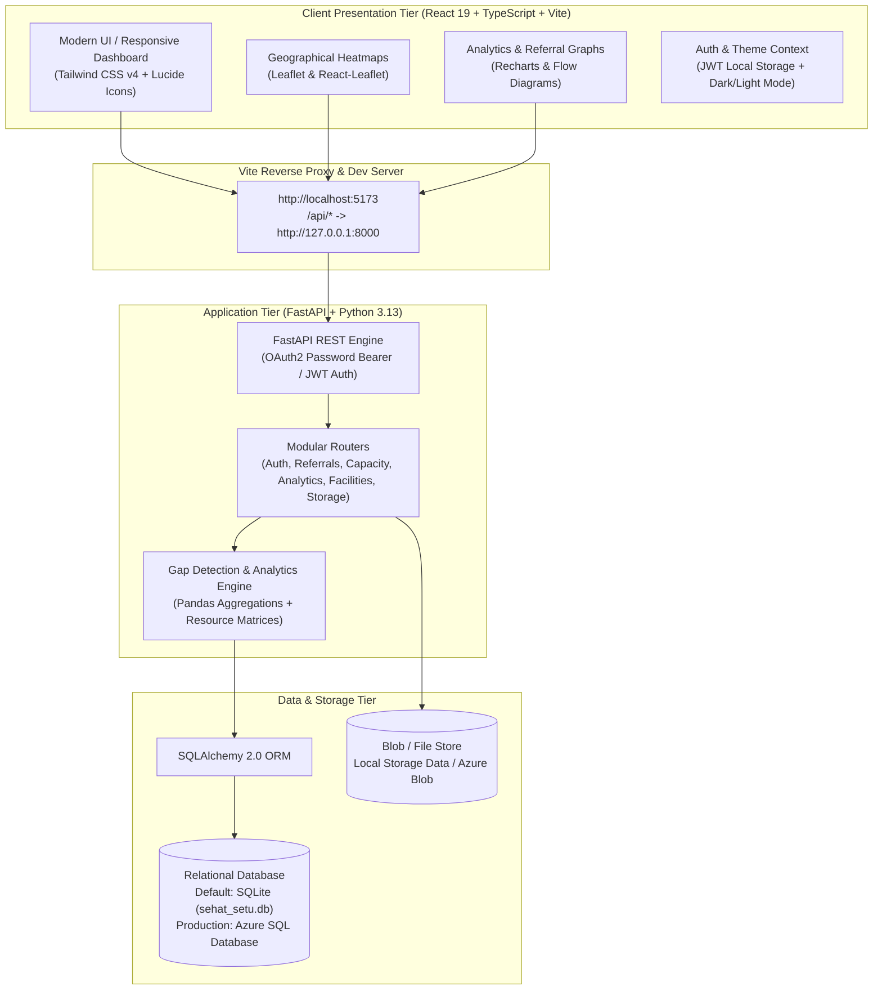

# 🏥 SEHAT-SETU (सेहत सेतु)
### *Healthcare Referral Analytics & Resource Gap Identification Platform*

[](https://fastapi.tiangolo.com)
[](https://react.dev/)
[](https://www.typescriptlang.org/)
[](https://vitejs.dev/)
[](https://tailwindcss.com/)
[](https://www.sqlite.org/)
[](LICENSE)

---

## 📌 Executive Summary

**SEHAT-SETU** (*"Bridge of Health"*) is an intelligent healthcare referral tracking and data analytics platform architected to optimize public health resource allocation. It monitors inter-facility patient referrals across primary, secondary, and tertiary public healthcare institutions to detect critical systemic bottlenecks—including specialist deficits, diagnostic equipment failures, and bed capacity saturation.

By unifying multi-tier geographic data (Facility $\rightarrow$ District $\rightarrow$ State $\rightarrow$ National) into interactive visual dashboards, geographical heatmaps, and automated gap detection engines, **SEHAT-SETU** empowers healthcare administrators and policy makers to transition from reactive management to proactive, data-driven healthcare planning.

---

## 🌟 Key Features

### 🔍 1. Automated Healthcare Gap & Deficit Detection
- **Equipment Deficit Recognition:** Identifies high-frequency outbound referrals driven by missing or non-functional equipment (e.g., Echocardiogram probes, CT/MRI units).
- **Specialist & Human Resource Deficits:** Flags facilities unable to handle routine cases due to lack of medical specialists (e.g., Cardiologists, Neurologists).
- **Bed & ICU Saturation Alerts:** Detects facilities turning away emergency referrals due to ward or ICU capacity overload.

### 📊 2. Multi-Level Analytics & Decision Dashboards
- **National / State Overview:** High-level KPIs, total patient referral volumes, top referral reasons, and cross-state mobility patterns.
- **District & Facility-Level Drilldown:** Granular views into facility performance, inward/outward referral ratios, and localized gaps.
- **Geographical Heatmaps & Network Graphs:** Interactive Leaflet GIS maps and graph networks displaying patient transfer corridors and flow intensity.

### 🛡️ 3. Role-Based Access Control (RBAC)
Dedicated views and administrative privileges partitioned across 5 distinct tiers:
1. **National Officer (DGHS):** Nationwide monitoring, policy planning, and cross-state resource redistribution.
2. **State Health Director:** State-wide analytics, district budgeting, and inter-district triage.
3. **District Chief Medical Officer (CMO):** District hospital capacity management and local gap mitigation.
4. **Facility Staff / Medical Officer:** Inward/outward referral creation, patient triage, and real-time service capacity updates.
5. **System Administrator:** System configuration, user provisioning, security audits, and storage management.

### 📑 4. Seamless Ingestion & Audit Compliance
- **Direct Referral Creation:** Fast multi-step triage form with urgent priority flagging.
- **Bulk Data Ingestion:** Upload historical and batch referral records via CSV or Excel (`.xlsx`) with instant schema validation.
- **Complete Activity Audit Trail:** Immutable logging of user logins, referral dispatches, capacity status adjustments, and triage updates.

---

## 🏗️ System Architecture



---

## 💻 Tech Stack

| Domain | Technology / Library | Purpose |
| :--- | :--- | :--- |
| **Frontend** | React 19, TypeScript, Vite | High-performance, type-safe Single Page Application (SPA) |
| **Styling** | Tailwind CSS v4, Framer Motion, Lucide React | Modern, accessible responsive design with fluid animations |
| **Data Viz** | Recharts, Leaflet, React-Leaflet | Dynamic charts, GIS geospatial heatmaps, and referral flow networks |
| **Backend API** | FastAPI, Uvicorn, Python 3.13 | High-throughput asynchronous REST API framework |
| **ORM & DB** | SQLAlchemy 2.0, SQLite / Azure SQL | Flexible database layer with seamless SQLite/SQL Server switching |
| **Data Processing**| Pandas, Python-Multipart, PyODBC | CSV/Excel batch processing and tabular analytics |
| **Authentication** | PyJWT, Passlib, Bcrypt | Secure JWT token-based RBAC authentication |

---

## 🚀 Step-by-Step Local Setup Guide

Follow these instructions to run both the backend API and frontend client on your local computer.

### 📋 Prerequisites
Ensure you have the following installed on your system:
- **Python 3.10+** (Tested with Python 3.13) — [Download Python](https://www.python.org/downloads/)
- **Node.js 18+ & npm** (Tested with Node.js v24 & npm 11) — [Download Node.js](https://nodejs.org/)
- **Git** — [Download Git](https://git-scm.com/)

---

### 1️⃣ Clone the Repository
```bash
git clone https://github.com/akash15773728/Sem3_Project.git
cd Sem3_Project
```

---

### 2️⃣ Backend Setup (FastAPI & Database)

1. **(Optional) Create and activate a virtual environment:**
   ```bash
   # Windows (PowerShell)
   python -m venv venv
   .\venv\Scripts\Activate.ps1

   # Linux / macOS
   python3 -m venv venv
   source venv/bin/activate
   ```

2. **Install Python dependencies:**
   ```bash
   pip install -r requirements.txt
   ```

3. **Configure Environment Variables (Optional):**
   A default fallback configuration is already built-in. If you wish to customize secrets or connect to an Azure SQL instance, create a `.env` file in the project root:
   ```env
   SECRET_KEY=your_super_secret_jwt_key
   # SQLite fallback is used automatically if DATABASE_URL is omitted:
   DATABASE_URL=sqlite:///./sehat_setu.db
   ```

4. **Start the Backend Server:**
   ```bash
   python -m uvicorn backend.app.main:app --host 127.0.0.1 --port 8000 --reload
   ```
   > 💡 **Auto-Seeding:** On first launch, the server automatically initializes SQLite tables and populates them with sample facilities across Delhi NCR, Maharashtra, and Karnataka, user accounts, and a 50+ referral gap analysis scenario!

---

### 3️⃣ Frontend Setup (React + Vite)

Open a **new terminal tab/window**:

1. **Navigate to the frontend directory:**
   ```bash
   cd frontend
   ```

2. **Install Node modules:**
   ```bash
   npm install
   ```

3. **Launch the Frontend Development Server:**
   ```bash
   npm run dev
   ```

---

### 4️⃣ Access the Application

Once both servers are running:
- 🌐 **Frontend Application:** [http://localhost:5173](http://localhost:5173)
- 📖 **Interactive Swagger API Docs:** [http://127.0.0.1:8000/docs](http://127.0.0.1:8000/docs)
- 🩺 **Backend Health Endpoint:** [http://127.0.0.1:8000/api/health](http://127.0.0.1:8000/api/health)

---

## 🔑 Pre-Seeded Demo Credentials

The database comes pre-seeded with test accounts representing every tier of public healthcare governance. Use any of the credentials below to log into [http://localhost:5173/login](http://localhost:5173/login):

| Role | Email Address | Password | Geographic Scope / Assigned Facility |
| :--- | :--- | :--- | :--- |
| **System Administrator** | `admin@sehatsetu.gov.in` | `Admin@123` | Full system governance, audit logs & user management |
| **National Officer** | `national@sehatsetu.gov.in` | `National@123` | DGHS / Ministry level – Nationwide oversight |
| **State Director** | `state@sehatsetu.gov.in` | `State@123` | State Health Mission – Delhi NCR & regional hospitals |
| **District Officer** | `district@sehatsetu.gov.in` | `District@123` | Chief Medical Officer (CMO) – Central Delhi |
| **Facility Staff** | `staff@sehatsetu.gov.in` | `Staff@123` | CHC Paharganj (Hospital A) – Outward referrals & capacity |

---

## 🧪 Key Test Scenario: Equipment Deficit Detection

The pre-seeded database includes an authentic test case designed to showcase automated gap detection:
1. **CHC Paharganj (Hospital A)** is marked with `equipment_available = False` for **Cardiology** (Echocardiogram device defect).
2. **50 Outward Echocardiogram Referrals** have been recorded originating from CHC Paharganj to higher tertiary centers (*District Hospital Central* & *Apex Medical College*).
3. **Observation:** 
   - Navigate to **Gap Analysis** (`/gap-analysis`) or **Analytics** (`/analytics`) as a District, State, or National Officer.
   - The platform automatically flags **Cardiology Echocardiogram Equipment Deficit** as the top priority systemic bottleneck, quantifying total diverted cases, distance traveled, and recommended procurement actions.

---

## 📂 Project Directory Structure

```plaintext
SEHAT-SETU/
├── backend/
│   ├── app/
│   │   ├── routers/            # Modular FastAPI endpoints
│   │   │   ├── activity_logs.py
│   │   │   ├── analytics.py    # Referral trends, heatmaps, gap detection
│   │   │   ├── auth.py         # JWT generation, verification, user login
│   │   │   ├── capacity.py     # Bed & specialist status by hospital
│   │   │   ├── districts.py
│   │   │   ├── facilities.py
│   │   │   ├── referrals.py    # Referral CRUD and batch uploads
│   │   │   ├── services.py
│   │   │   ├── storage.py      # Azure blob / local file management
│   │   │   └── users.py
│   │   ├── auth.py             # Password hashing and token security
│   │   ├── config.py           # Application settings and environment variables
│   │   ├── database.py         # SQLAlchemy engine and session factory
│   │   ├── main.py             # FastAPI entry point and CORS configuration
│   │   ├── models.py           # SQLAlchemy relational schema
│   │   ├── schemas.py          # Pydantic request/response validators
│   │   ├── seed.py             # Realistic multi-district seed dataset
│   │   └── storage_data/       # Local fallback directory for documents
│   └── tests/                  # Direct API endpoint unit tests
├── frontend/
│   ├── public/                 # Static public assets
│   ├── src/
│   │   ├── components/         # Reusable UI elements, maps, network graphs
│   │   ├── context/            # Auth and theme context providers
│   │   ├── layouts/            # Dashboard layout and navigation sidebar
│   │   ├── pages/              # Application pages (Dashboards, Analysis, Triage)
│   │   ├── services/           # Axios / Fetch API client helpers
│   │   ├── App.tsx             # Root router and route guards
│   │   └── main.tsx            # React application entry point
│   ├── package.json
│   ├── tailwind.config.ts
│   └── vite.config.ts
├── SEHAT_SETU_RDBMS_Schema.sql                 # Production RDBMS DDL script
├── SEHAT_SETU_RDBMS_Queries(production level).sql # Analytical SQL queries
├── SEHAT_SETU_RDBMS_ER_Diagram (1).png        # Relational database diagram
├── system_Design_threat_model.pdf              # Security architecture documentation
├── requirements.txt                            # Backend Python dependencies
└── README.md                                   # Project documentation
```

---

## 📡 Core API Endpoints

| Method | Endpoint | Description | Access |
| :--- | :--- | :--- | :--- |
| `POST` | `/api/auth/token` | Authenticate user & retrieve JWT bearer token | Public |
| `GET` | `/api/auth/me` | Fetch currently authenticated user profile | Authenticated |
| `GET` | `/api/analytics/kpis` | Retrieve high-level healthcare summary KPIs | Authenticated |
| `GET` | `/api/analytics/gap-analysis` | Automated resource bottleneck detection | Officer / Admin |
| `GET` | `/api/analytics/referral-flows` | Origin-to-destination referral flows for graph | Authenticated |
| `GET` | `/api/referrals` | List, filter, and paginate patient referrals | Authenticated |
| `POST` | `/api/referrals` | Create a new patient referral | Staff / Admin |
| `POST` | `/api/referrals/upload` | Ingest batch referrals via CSV or Excel file | Staff / Admin |
| `GET` | `/api/capacity` | Real-time bed, specialist, and equipment status | Authenticated |
| `GET` | `/api/facilities` | List hospitals and clinics with coordinates | Authenticated |
| `GET` | `/api/activity-logs` | Comprehensive security & audit log events | Admin |

---

## 🔒 Security & Threat Modeling
- **Zero-Trust Role Enforcements:** Endpoints are strictly guarded with FastAPI dependency injection (`get_current_active_user`).
- **Encrypted Credentials:** Passwords hashed with cryptographic `bcrypt` algorithms.
- **Data Protection:** Sanitized input schemas via Pydantic; SQL-injection-proof queries through SQLAlchemy ORM parameterization.
- **Detailed Threat Model:** Refer to [`system_Design_threat_model.pdf`](system_Design_threat_model.pdf) for the complete security architecture and STRIDE analysis.

---

## 📄 License
This project is open-source and distributed under the **MIT License**. See the `LICENSE` file for details.

---

<p align="center">
  <b>Built for strengthening public health infrastructure and patient referral efficiency.</b>
</p>
